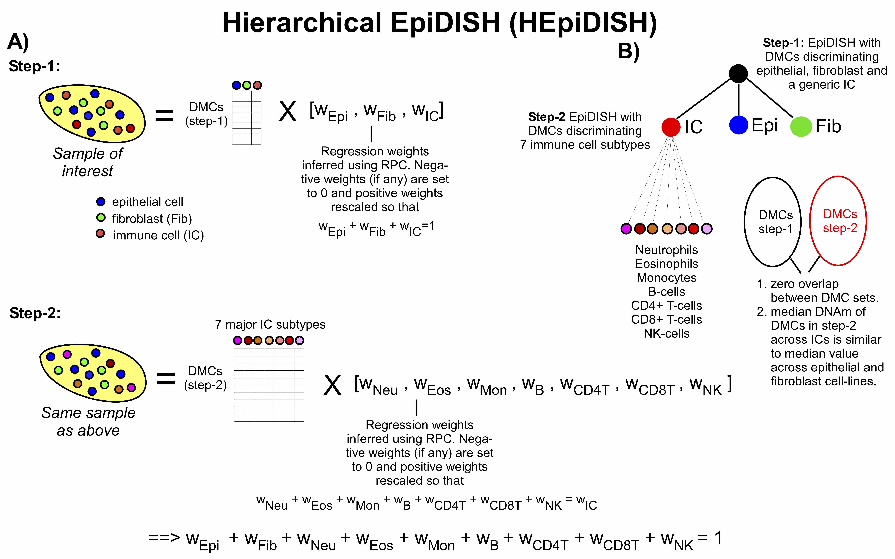
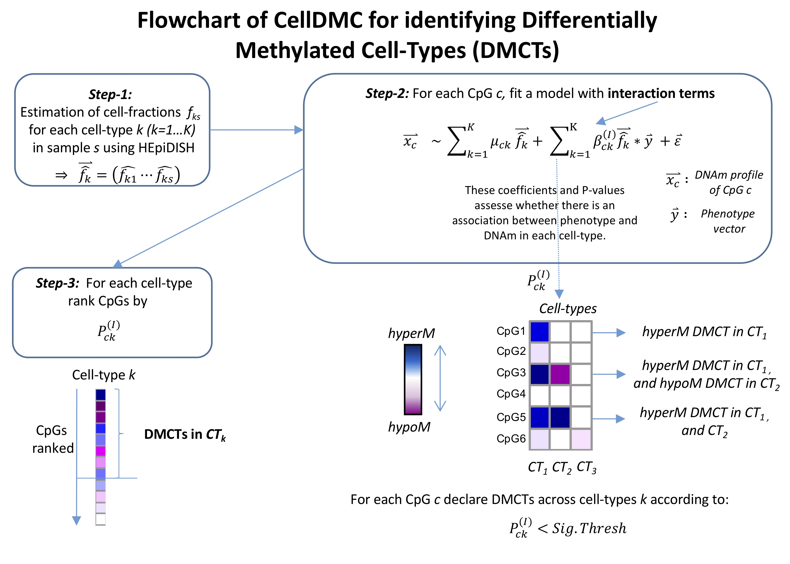

# Introduction

The **EpiDISH** package provides tools to infer the fractions of a priori known cell subtypes present in a DNA methylation (DNAm) sample representing a mixture of such cell-types. Inference proceeds via one of 3 methods (Robust Partial Correlations-RPC[@EpiDISH], Cibersort-CBS[@CBS], Constrained Projection-CP[@CP]), as determined by the user. Besides, we also provide a function - CellDMC which allows the identification of differentially methylated cell-types in Epigenome-Wide Association Studies(EWAS)[@CellDMC]. For now, *the package contains 7 DNAm reference matrices*, three of which are designed for *adult whole blood* [@EpiDISH] and [@MetaEWAS], and one which is designed for blood tissue of any age, including cord-blood and blood from infants, children, adolescents and adults.

1. `centDHSbloodDMC.m`: This DNAm reference matrix for blood will estimate fractions for 7 immune cell types (B-cells, NK-cells, CD4T and CD8T-cells, Monocytes, Neutrophils and Eosinophils).
2. `cent12CT.m`: This DNAm reference matrix for blood and EPIC-arrays will estimate fractions for 12 immune-cell types (naive and mature B-cells, naive and mature CD4T-cells, naive and mature B-cells, T-regulatory cells, NK-cells, Neutrophils, Monocytes, Eosinophils, Basophils).
3. `cent12CT450k.m`: This DNAm reference matrix for blood and Illumina 450k-arrays will estimate fractions for 12 immune-cell types (naive and mature B-cells, naive and mature CD4T-cells, naive and mature B-cells, T-regulatory cells, NK-cells, Neutrophils, Monocytes, Eosinophils, Basophils).
4. `centUniLIFE.m`: This DNAm reference matrix for blood-tissue of any age will estimate fractions for 19 immune-cell types including 7 youthful cord-blood subtypes (B-cells, NK-cells, Granulocytes, Monocytes, nRBCs, CD4T and CD8T-cells) and 12 adult immune cell types (naive and mature B-cells, naive and mature CD4T-cells, naive and mature B-cells, T-regulatory cells, NK-cells, Neutrophils, Monocytes, Eosinophils, Basophils).


The other 3 DNAm reference matrices are designed for solid tissue-types [@HEpiDISH]:

1. `centEpiFibIC.m`: This DNAm reference matrix is designed for a generic solid tissue that is dominated by an epithelial, stromal and immune-cell component. It will estimate fractions for 3 broad cell-types: a generic epithelial, fibroblast and immune-cell type.
2. `centBloodSub.m`: This DNAm reference matrix is designed for a solid tissue-type and will estimate immune cell infiltration for 7 immune cell subtypes. This DNAm reference matrix is meant to be applied after `centEpiFibIC.m` to yield proportions for 7 immune cell subtypes alongside the total epithelial and total fibroblast fractions.
3. `centEpiFibFatIC.m`: This DNAm reference matrix is a more specialised version for breast tissue and will estimate total epithelial, fibroblast, immune-cell and fat fractions.


# How to estimate cell-type fractions in blood

We show an example of using our package to estimate 7 immune cell-type fractions in adult whole blood. We use a subset beta value matrix of GSE42861 (detailed description in manual page of *LiuDataSub.m*). First, we read in the required objects:
```{r load, eval=TRUE, echo=T, message=FALSE, warning=FALSE}
library(EpiDISH)
data(centDHSbloodDMC.m)
data(LiuDataSub.m)
```

```{r inferBlood, eval=TRUE, echo=T, message=FALSE, warning=FALSE}
BloodFrac.m <- epidish(beta.m = LiuDataSub.m, ref.m = centDHSbloodDMC.m, method = "RPC")$estF
```

We can easily check the inferred fractions with boxplots. From the boxplots, we observe that just as we expected, the major cell-type in whole blood is neutrophil.
```{r boxplot, eval=TRUE, echo=T, message=FALSE, warning=FALSE, fig.height = 5, fig.width = 8, fig.align = "center"}
boxplot(BloodFrac.m)
```

If we wanted to infer fractions at a higher resolution of 12 immune cell subtypes, we would replace `centDHSbloodDMC.m` in the above with `cent12CT450k.m` because this is a 450k DNAm dataset. For an EPIC whole blood dataset, you would use `cent12CT.m`.

# How to estimate generic cell-type fractions in a solid tissue
To illustrate how this works, we first read in a dummy beta value matrix *DummyBeta.m*, which contains 2000 CpGs and 10 samples, representing a solid tissue:
```{r load2, eval=TRUE, echo=T, message=FALSE, warning=FALSE}
data(centEpiFibIC.m)
data(DummyBeta.m)
```
Notice that *centEpiFibIC.m* has 3 columns, with names of the columns as EPi, Fib and IC. We go ahead and use *epidish* function with *RPC* mode to infer the cell-type fractions.
```{r infer, eval=TRUE, echo=T, message=FALSE, warning=FALSE}
out.l <- epidish(beta.m = DummyBeta.m, ref.m = centEpiFibIC.m, method = "RPC") 
```

Then, we check the output list. *estF* is the matrix of estimated cell-type fractions. *ref* is the reference centroid matrix used, and *dataREF* is the subset of the input data matrix over the probes defined in the reference matrix.
```{r check, eval=TRUE, echo=T, message=FALSE, warning=FALSE}
out.l$estF
dim(out.l$ref)
dim(out.l$dataREF)
```

Note: As part of the quality control step in DNAm data preprocessing, we might have to remove bad probes; consequently, not all probes in the reference matrix may be available in a given dataset. By checking *ref* and *dataREF*, we can extract the probes actually used for estimating cell-type fractions. As shown by us [@HEpiDISH], if the proportion of missing reference matrix probes is more than a third, then estimated fractions may be unreliable. 


# How to use the eight-cell-type pan-tissue references

Use `pantissue8CTepic2.m` for EPIC v2 or `pantissue8CTmsa.m` for MSA arrays. The `pantissue8CT.m`
matrix is for Illumina 450K and EPIC v1 arrays.

```{r pantissue-reference, eval=FALSE}
data(pantissue8CTepic2.m, package = "EpiDISH")
fit <- epidish(beta.m = epic2_beta.m, ref.m = pantissue8CTepic2.m)
fit$estF
calculate_mFDI(fit)
```

The extrinsic mFDI uses the estimated fibroblast and epithelial
fractions. The cell-intrinsic EpiEMT score is computed from a cohort
beta matrix using `calculate_EMTS(beta.m)`.

# How to estimate immune cell-type fractions in a solid tissue using HEpiDISH
HEpiDISH is an iterative hierarchical procedure of EpiDISH designed for solid tissues with significant immune-cell infiltration. HEpiDISH uses two distinct DNAm references, a primary reference for the estimation of total epithelial, fibroblast and immune-cell fractions, and a separate secondary non-overlapping DNAm reference for the estimation of underlying immune cell subtype fractions. 
 
In this example, the third cell-type in the primary DNAm reference matrix is the total immune cell fraction. We would like to know the fractions of 7 immune cell subtypes, in adddition to the epithelial and fibroblast fractions. So we use a secondary reference, which contains 7 immnue cell subtypes, and let **hepidish** function know that the third column of primary reference should correspond to the secondary DNAm reference matrix. (We only include 3 cell-types of the *centBloodSub.m* reference because we mixed those three cell-types to generate the dummy beta value matrix.)
```{r hepidish, eval=TRUE, echo=T, message=FALSE, warning=FALSE}
data(centBloodSub.m)
frac.m <- hepidish(beta.m = DummyBeta.m, ref1.m = centEpiFibIC.m, ref2.m = centBloodSub.m[,c(1, 2, 5)], h.CT.idx = 3, method = 'RPC')
frac.m
```


# More info about different methods for cell-type fractions estimation
We compared CP and RPC in [@EpiDISH]. And we also published a review article[@review] which discusses most of algorithms for tackling cell heterogeneity in Epigenome-Wide Association Studies(EWAS). Refer to references section for more details.


# How to identify differentially methylated cell-types in EWAS
After estimating cell-type fractions, we can then identify differentially methylated cell-types and their directions of change using **CellDMC** [@CellDMC]function. The workflow of **CellDMC** is shown below.



We use a binary phenotype vector here, with half of them representing controls and other half representing cases.
```{r celldmc, eval=TRUE, echo=T, message=FALSE, warning=FALSE}
pheno.v <- rep(c(0, 1), each = 5)
celldmc.o <- CellDMC(DummyBeta.m, pheno.v, frac.m)
```

The DMCTs prediction is given(pls note this is faked data. The sample size is too small to find DMCTs.):
```{r dmct, eval=TRUE, echo=T, message=FALSE, warning=FALSE}
head(celldmc.o$dmct)
```
The estimated coefficients for each cell-type are given in the *celldmc.o$coe*.
Pls refer to help page of **CellDMC** for more info.


# Sessioninfo

```{r sessionInfo, echo=FALSE}
sessionInfo()
```

# References


